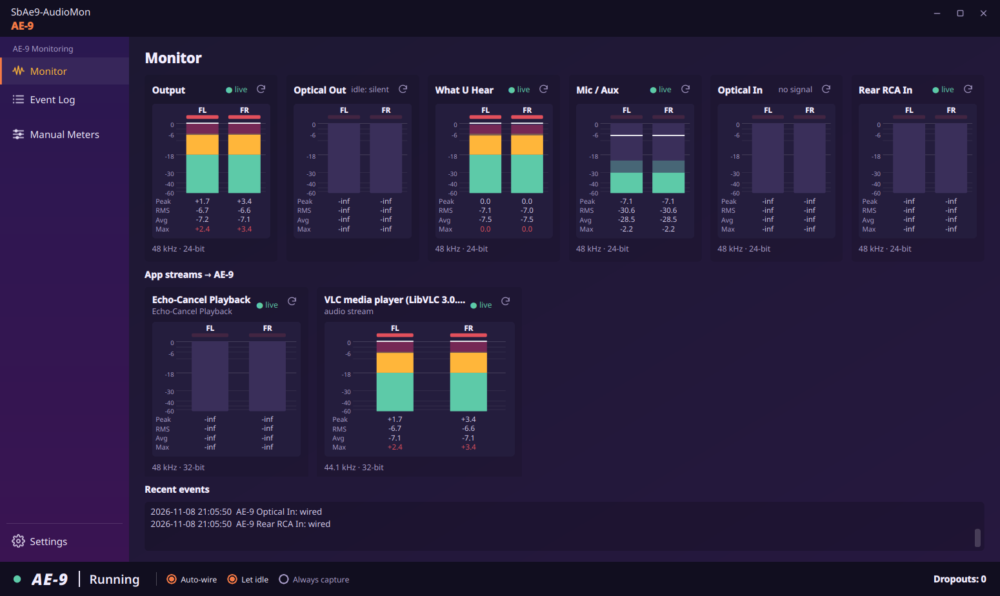
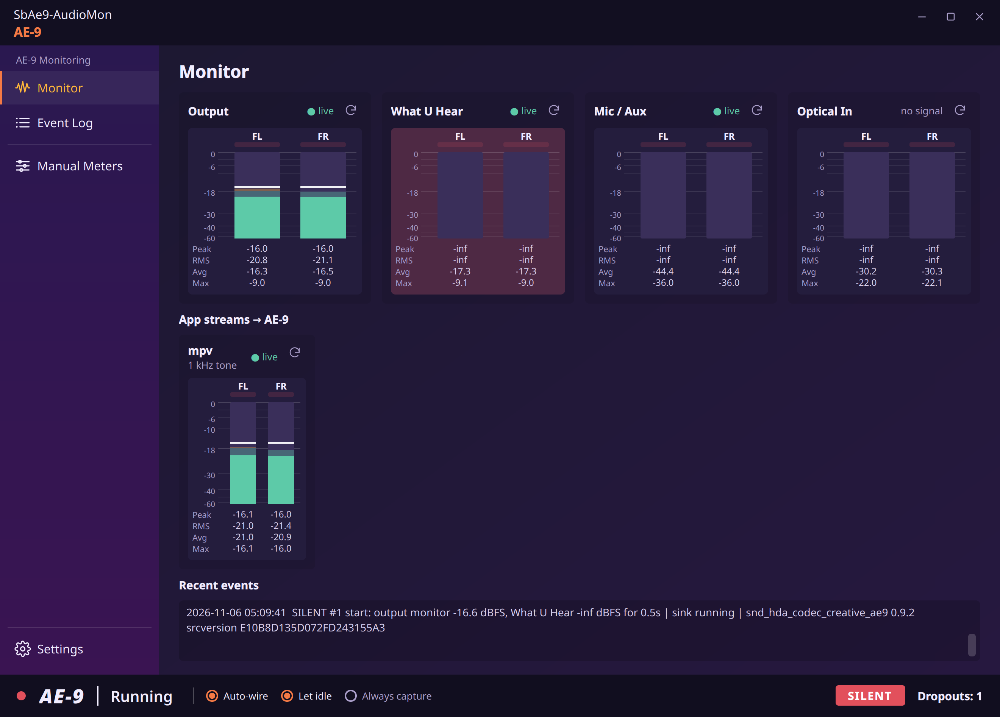
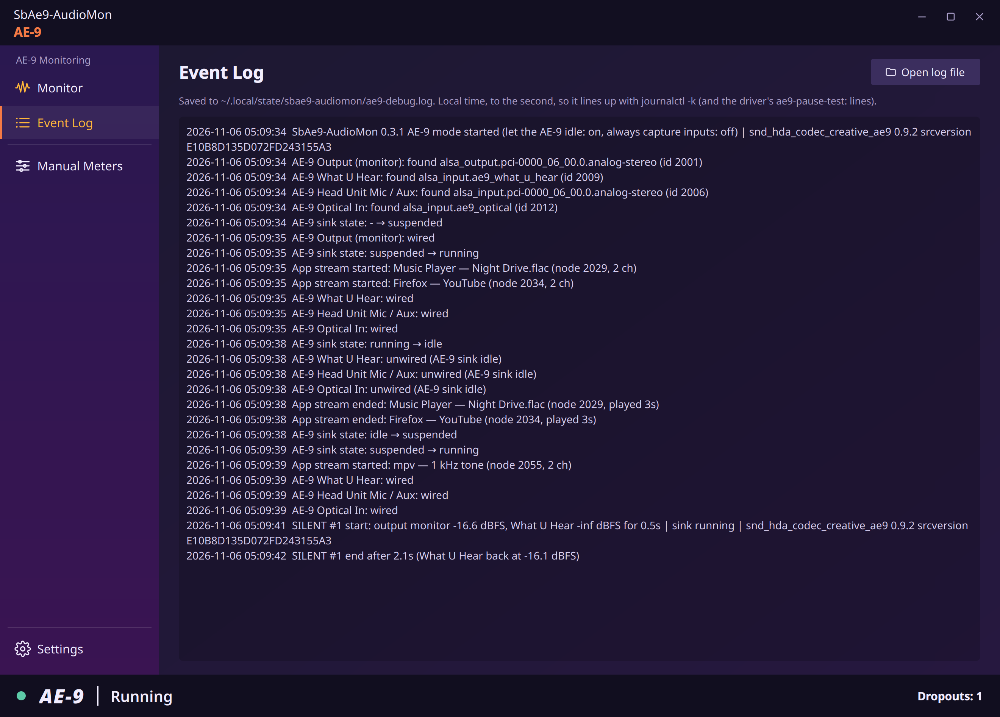
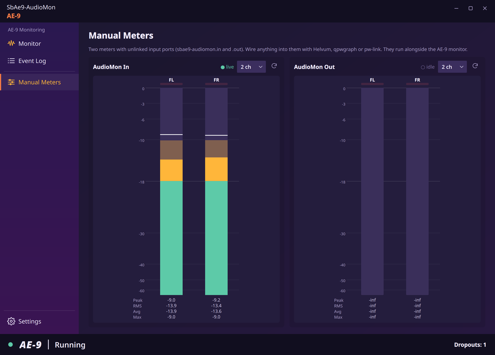
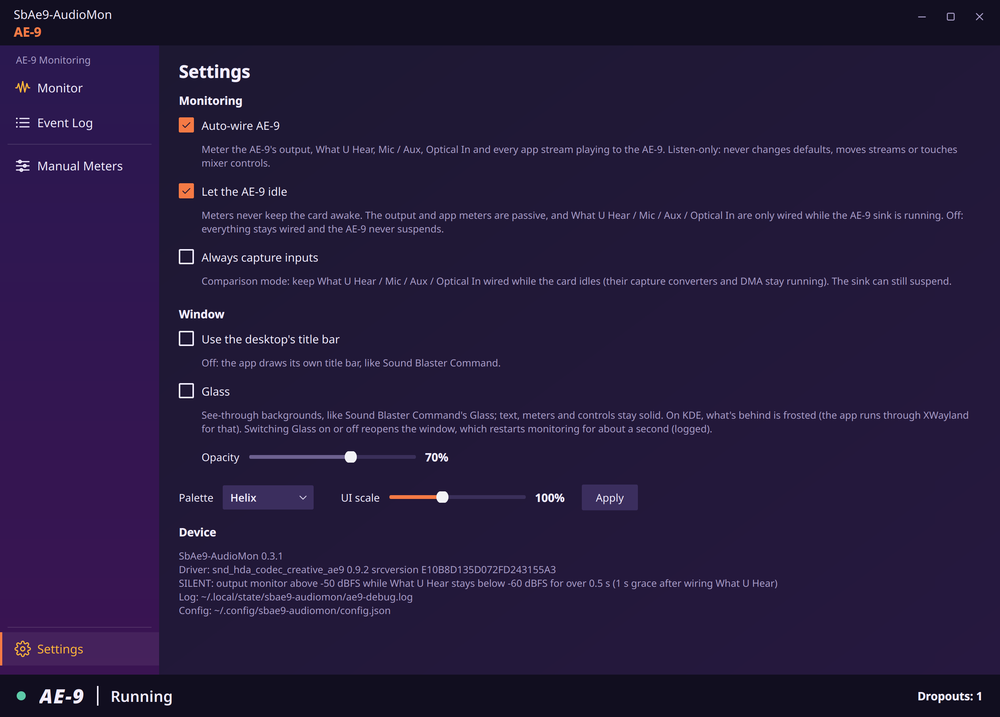
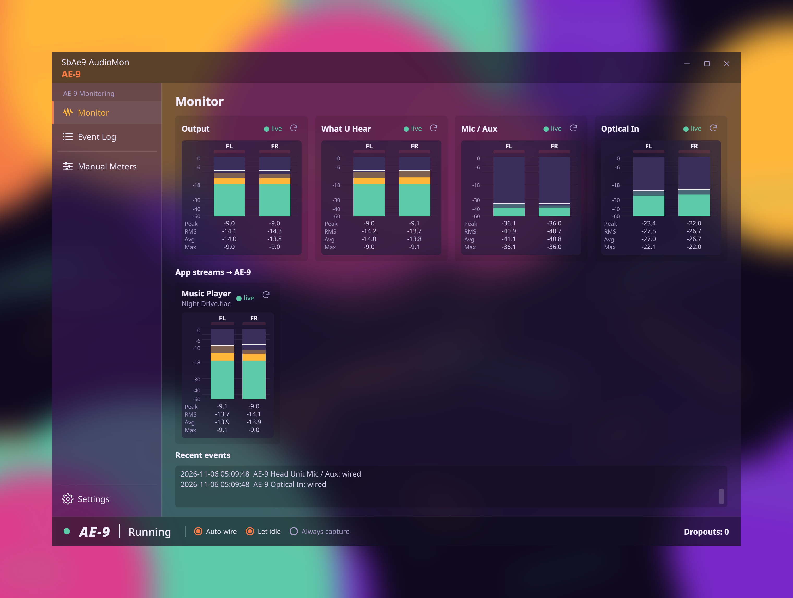

# SbAe9-AudioMon

Lightweight PipeWire VU meters (Qt 6 / PySide6), with a debug mode for the
Sound Blaster AE-9. The listen-only companion to
[SbAe9-SBC](https://github.com/3xHelix/SbAe9-SBC) (Sound Blaster Command for
Linux). Both apps are built on one shared base,
[SbAe9-Kit](https://github.com/3xHelix/SbAe9-Kit) (vendored here as
`sbae9kit/`), so they look, run, install and test the same way.

## Screenshots


<sub>The Monitor page on a real AE-9, with VLC playing and the head unit's mic
live. The output and What U Hear agree, so the card is playing what PipeWire
sends it. The card's optical in jack is dark.</sub>

<table>
  <tr>
    <td><br><sub>A silent restart caught: the output plays, What U Hear stays silent</sub></td>
    <td><br><sub>Event Log: suspend, resume and the SILENT, timestamped to the second</sub></td>
  </tr>
  <tr>
    <td><br><sub>Manual Meters, with a player wired in by hand</sub></td>
    <td><br><sub>Settings</sub></td>
  </tr>
</table>

Shown in the Helix palette. All but the first come from the fake AE-9, so the
dropout can be shown on demand. Regenerate them with
`python3 tools/screenshots.py [--palette NAME]`.

**Glass** (Settings → Window): frosted, see-through backgrounds on any
palette, here Helix at 70%.


<sub>Rendered offscreen with `python3 tools/screenshots.py --glass`,
over a backdrop blurred the way KDE frosts it. On the desktop, KWin does the
blur.</sub>

## Window

- **Title bar:** the app draws its own, like Sound Blaster Command. Drag it to
  move the window and double-click to maximize. Use Settings, or `--frame`, to
  get the desktop's title bar back.
- **Pages (sidebar):**
  - **Monitor:** the AE-9 meters, app streams and recent events.
  - **Event Log:** the full debug log, with a button to open the log file.
  - **Manual Meters:** two meters you wire by hand.
  - **Settings:** monitoring options, the window options (title bar, Glass,
    palette, UI scale) and driver/log/config info.
- **Palettes:** Helix (the default), Command, Albino or Wololo, the same ones
  as Sound Blaster Command (Settings → Window, or `--palette`). Changing it
  rebuilds the window, so the meters restart for a moment.
- **UI scale:** 70–150% (Settings → Window, or `--scale`). It reopens the
  window and, on Wayland, runs it through XWayland, as SBC does.
- **Glass** (Settings → Window, or `--glass`): see-through backgrounds, the
  same as Sound Blaster Command's Glass. Text, meters and controls stay solid.
  An Opacity slider (30–95%) works live. On KDE what's behind is frosted;
  the app runs through XWayland for that, since KDE only blurs X11 windows.
  Switching Glass on or off reopens the window, which restarts monitoring for
  about a second, and the debug log says so.
- **Meter cards:** each shows a short name (Output, What U Hear, Mic / Aux,
  Optical In) and its state. Hover the title for the full name, the jacks it
  covers and its PipeWire node.
- **Bottom bar:**
  - a status dot: green = running, amber = idle, grey = suspended, red = SILENT or card missing;
  - the AE-9 sink state;
  - on the Monitor page, quick toggles for the three Settings → Monitoring options
    (Auto-wire, Let idle, Always capture), kept in sync with Settings;
  - the **SILENT** badge;
  - the dropout count.

## Modes

### AE-9 mode (default)

SbAe9-AudioMon finds the AE-9's PipeWire nodes by name/card and wires a meter to each:

| Meter | Source | Meter node |
|-------|--------|-----------|
| AE-9 Output (monitor) | the AE-9 sink's monitor ports: what PipeWire sends to the card (its RCA out in speaker mode, the head unit's headphone jacks in headphone mode) | `sbae9-audiomon.ae9.monitor` |
| AE-9 What U Hear | `alsa_input.ae9_what_u_hear` (what the card actually plays, after its DSP) | `sbae9-audiomon.ae9.wuh` |
| AE-9 Head Unit Mic / Aux | the head unit's input: the XLR/TRS jack and the 3.5 mm mic jack, which share it (`alsa_input.pci-…analog-stereo`, hw:AE9,0) | `sbae9-audiomon.ae9.mic` |
| AE-9 Optical In | the card's optical in jack, `alsa_input.ae9_optical` (shows "no signal" without light on the jack) | `sbae9-audiomon.ae9.optical` |
| one per app stream | every app stream playing to the AE-9 sink, added/removed as they come and go | `sbae9-audiomon.stream.<id>` |

Nodes are re-found and re-wired automatically when the card drops off and comes
back (PSU cycle, driver reload, suspend).

**Listen-only.** SbAe9-AudioMon never changes the default sink/source, never moves or
relinks app streams, and never touches ALSA mixer controls. The only links it
creates or removes are its own, from AE-9 / stream ports into its meter nodes.

**SILENT flag.** Lights up (and counts a dropout) when the output monitor has
signal (> -50 dBFS peak) but What U Hear stays below -60 dBFS for more than
0.5 s. What U Hear is ignored for 1 s after it's (re)wired so it can start up.
Thresholds are constants at the top of `audiomon/monitor.py`.

**Let the AE-9 idle** (on by default). Meters must not stop the card from
suspending:

- The output-monitor and app-stream meters are passive nodes (`node.passive`),
  so they only receive data while the card is running anyway.
- What U Hear, the head unit's Mic / Aux and Optical In have to actively capture, so they're only
  wired while the AE-9 sink is `running`, and they're unwired as soon as it goes idle.
  This means nothing of ours holds an AE-9 PCM open while it idles or suspends.

Turn it off (or run with `--keep-awake`) to keep everything wired all the time.
That keeps the AE-9 running permanently.

**Always capture inputs** (off by default, `--always-capture`) is a comparison
mode. The output and app meters stay passive, so the sink can still suspend,
but What U Hear, the head unit's Mic / Aux and Optical In stay wired all the time. That keeps the card's
capture converters and DMA running while playback is idle. Use it to check
whether open captures change the bug's behaviour.

**Debug log.** Saved to `~/.local/state/sbae9-audiomon/ae9-debug.log` and shown at
the bottom of the window. Times are local, to the second, to line up with
`journalctl -k` (e.g. the driver's `ae9-pause-test:` lines). It records:
- AE-9 nodes appearing and disappearing;
- sink state changes (running / idle / suspended);
- wiring changes;
- app streams starting and ending;
- SILENT start and end.

SILENT lines and card (re)appearances include the driver version and srcversion
from `/sys/module/snd_hda_codec_creative_ae9/`.

### Manual meters

The **Manual Meters** page (`--manual` opens on it) has the original two meters,
**AudioMon In** (`sbae9-audiomon.in`) and **AudioMon Out** (`sbae9-audiomon.out`). Each
has 2/4/6/8 unlinked input ports to wire up yourself with Helvum, qpwgraph or
`pw-link`. Their nodes are created the first time you open the page, and they
run alongside the AE-9 monitor. Changing the channel count recreates that node,
so its links are dropped. To stop the AE-9 monitoring, untick **Auto-wire AE-9**
in Settings.

## Requirements

Python 3, PySide6 (Qt 6), numpy, and `pw-record` / `pw-link` / `pw-dump` (pipewire-utils).
On Fedora: `sudo dnf install python3-pyside6 python3-numpy pipewire-utils`

## Run

From the checkout:

    ./sbae9-audiomon                  # last-used settings (AE-9 mode the first time)
    ./sbae9-audiomon --ae9            # AE-9 mode
    ./sbae9-audiomon --ae9 --keep-awake
    ./sbae9-audiomon --manual -c 8    # open on Manual Meters, two 8-channel meters
    ./sbae9-audiomon --palette wololo --scale 120
    ./sbae9-audiomon --frame          # use the desktop's title bar
    ./sbae9-audiomon --log /path/to/file.log

Install for your user (the `sbae9-audiomon` command, its icon and a menu entry):

    ./install.sh

It installs a **copy** of the app in `~/.local/share/sbae9-audiomon`, the same
way as Sound Blaster Command, so the menu app is always the build you last
installed. Re-run it after each tested change.

## Layout

| Path | What it is |
|---|---|
| `sbae9-audiomon` | The launcher (runs the package from wherever it lives) |
| `audiomon/` | The app: `core` (constants, config), `pipewire` (graph, linking, AE-9 nodes), `capture` (pw-record meters), `meters`, `monitor` (AE-9 wiring, SILENT), `widgets`, `window`, `theme`, `eventlog` |
| `sbae9kit/` | The shared kit, vendored from SbAe9-Kit by its `tools/sync_kit.py`. Don't edit it here; `tests/test_kit.py` checks it's unchanged. AudioMon never imports its `mixer` (ALSA writes) |
| `appicon/` | The app icon, 16–512 px, cut by SbAe9-Kit's `tools/make_icons.py` from the artwork `Neon VU Meter Diagnostics.png` (kept outside the repo) |
| `tests/`, `tools/fake_ae9.py` | Tests and the demo on the fake AE-9 |
| `docs/`, `tools/screenshots.py` | The README screenshots, and the tool that renders them on the fake AE-9 |

## Testing without the card: the fake AE-9

The tests run on the shared fake AE-9, `sbae9kit.testing`, the same rig
Sound Blaster Command's tests use. `tests/support.py` plugs it into the app.
It starts from a snapshot of the real machine and fakes the PipeWire graph,
the meters (`pw-record`) and `pw-link`:
- The sink runs while an app plays to it, goes idle when nothing does, then suspends.
- What U Hear plays the output back at the same level (it's level-exact on the
  real card), or goes silent to fake the bug.
- Optical In sends digital silence without light on the jack, like the real card.
- The card can drop off and come back.

Nothing real is touched: no PipeWire, no card, no `~/.config`, and the debug
log goes to a temp folder.

    python3 -m unittest discover -s tests     # automated tests, ~15 s
    python3 tools/fake_ae9.py                 # the real window on the fake card, looping a scenario
    python3 tools/fake_ae9.py --list          # what the scenario does

The tests cover:
- finding the card;
- letting it suspend;
- passive meters;
- wiring inputs only while it runs;
- app streams starting and ending;
- SILENT start and end, with the driver version in the log;
- the card dropping off and coming back;
- Optical "no signal";
- keep-awake and always-capture modes;
- an older driver with no What U Hear;
- that every link goes only into our own meters, and that hand-made links are left alone;
- the bottom-bar toggles staying in step with Settings;
- Glass;
- the vendored kit being unchanged, and AudioMon never loading the kit's mixer.

The scenario plays music, lets the card idle and suspend, fakes a silent
restart (SILENT), drops the card and brings it back, then lights up Optical In.

## Reading the meters

- **Solid bar**: RMS with VU ballistics (300 ms). **Translucent bar**: sample peak (falls at 20 dB/s).
- **White line**: peak hold (2 s).
- **Red LED**: clip (sample >= 0 dBFS), latched until reset.
- **Stats**: `Peak` = held peak, `RMS` = current VU level, `Avg` = average RMS
  (Leq) since last reset, `Max` = highest peak since last reset.
- Colour zones: green < -18 dBFS < yellow < -6 dBFS < red.
- Click a meter or its ⟳ button to reset its stats. All values are dBFS.

## Config

Saved to `~/.config/sbae9-audiomon/config.json`:

```json
{
  "mode": "ae9",
  "let_idle": true,
  "always_capture": false,
  "frameless": true,
  "glass": false,
  "glass_opacity": 70,
  "palette": "helix",
  "ui_scale": 100,
  "page": 0,
  "meters": [
    {"name": "sbae9-audiomon.in",  "label": "AudioMon In",  "channels": 2},
    {"name": "sbae9-audiomon.out", "label": "AudioMon Out", "channels": 2}
  ]
}
```

## License

GPL-2.0-only, same as [SbAe9-SBC](https://github.com/3xHelix/SbAe9-SBC), whose Helix
styling, test snapshot and icon tool it shares. See [LICENSE](LICENSE).
