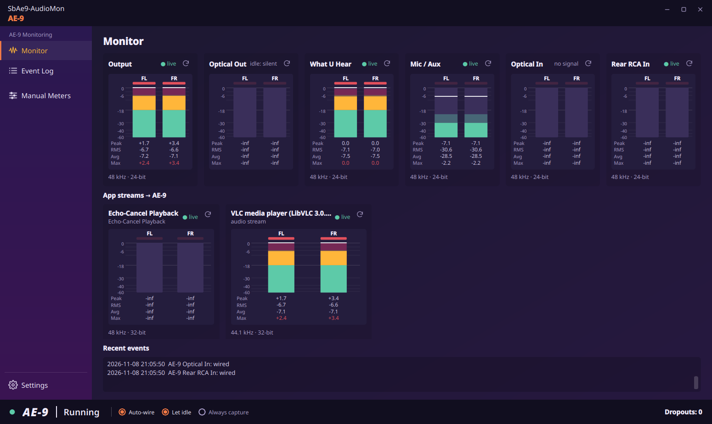
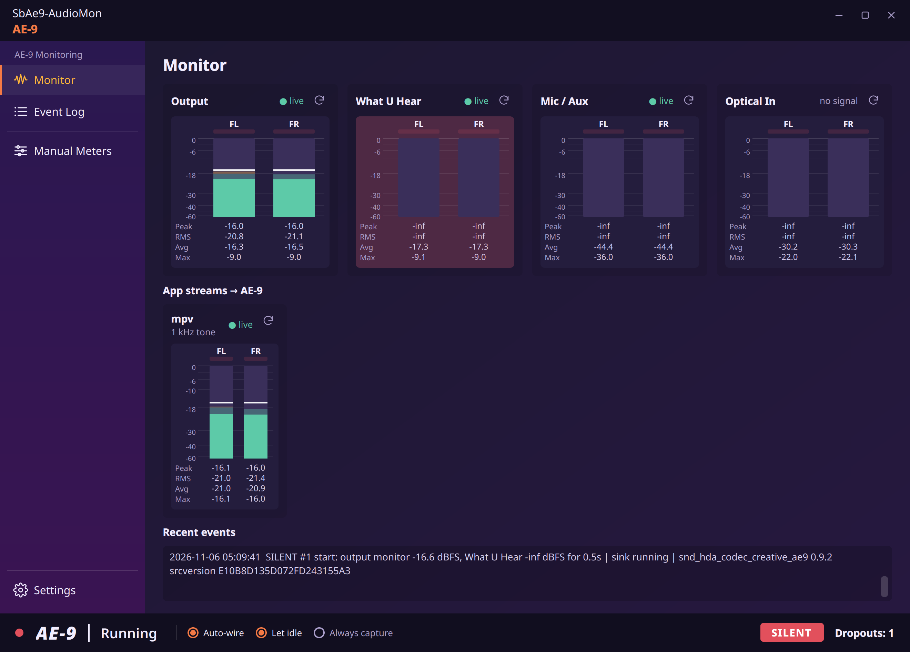
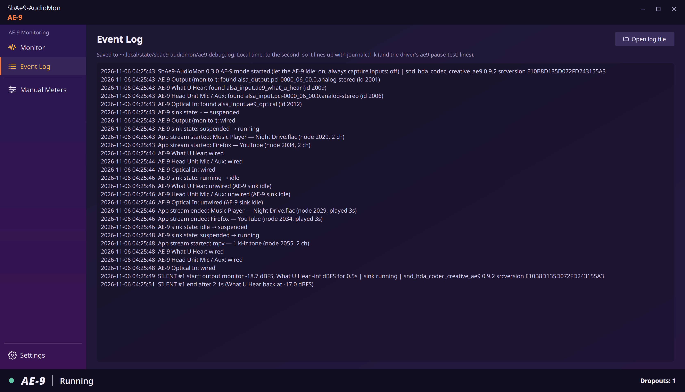
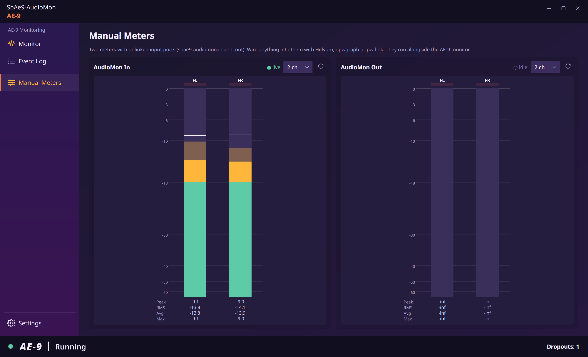
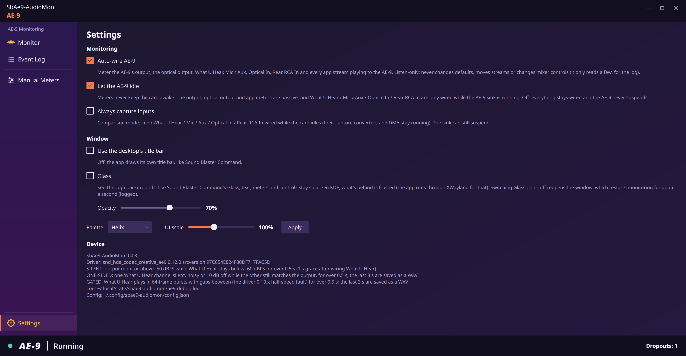
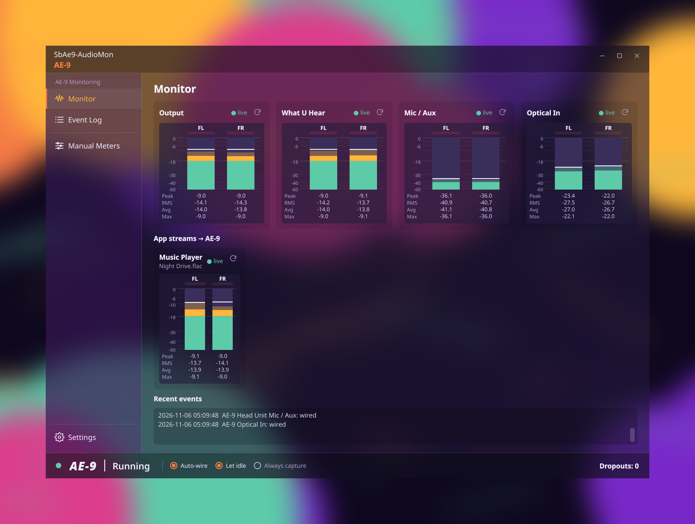

# SbAe9-AudioMon



Lightweight PipeWire VU meters with a debug mode for the **Creative Sound
Blaster AE-9**. It meters every input and output of the card and catches
dropouts the moment they happen.

It's the listen-only companion to
[Sound Blaster Command for Linux](https://github.com/3xHelix/SbAe9-SBC) and
the AE-9 driver, [SbAe9-Drv](https://github.com/3xHelix/SbAe9-Drv). It never
changes your audio: it only adds its own meter links and reads the driver's
controls.

This release pairs with
[SbAe9-Drv v0.12.16](https://github.com/3xHelix/SbAe9-Drv/releases/tag/v0.12.16).

---

## Highlights

- **Every AE-9 jack on one page**: Output, Optical Out, What U Hear, Mic /
  Aux, Optical In and Rear RCA In, plus a meter per app stream.
- **Dropout detection**: **SILENT**, **ONE-SIDED** and **GATED** flags catch
  the card going quiet, losing one side, or playing in bursts, and save a WAV.
- **Debug log** timestamped to the second, to line up with `journalctl -k`,
  with every driver setting change and the stream format.
- **Driver health** line and a notice when the card stops answering
  (driver 0.12.9+), letting go of the card so it can be reloaded, and while
  `ae9-reload` runs (driver 0.12.13+).
- **Lets the card idle**: meters never keep the AE-9 awake by default.
- **Manual Meters**: two 2 to 8 channel meters you wire up by hand.
- The same four palettes, **Glass** look and UI scaling as Sound Blaster
  Command.

---

## Install

The app is plain Python and installs the same way on every distro. Only the
package names in step 2 differ.

**1. Install the AE-9 driver.** Follow
[SbAe9-Drv's install steps](https://github.com/3xHelix/SbAe9-Drv) for your
distro. The latest release is best; see [Driver versions](#driver-versions).

**2. Install what the app needs.** Pick your distro *(💡 most desktops
already have everything except PySide6, so this often installs just that)*:

| Distro | Command |
|---|---|
| **Fedora** | `sudo dnf install python3-pyside6 python3-numpy pipewire-utils alsa-utils` |
| **Ubuntu 26.04+, Debian 13+** | `sudo apt install python3-pyside6.qtwidgets python3-pyside6.qtsvg python3-numpy pipewire-bin alsa-utils` |
| **Arch, Manjaro, EndeavourOS** | `sudo pacman -S pyside6 python-numpy pipewire pipewire-audio alsa-utils` |
| **openSUSE Tumbleweed** | `sudo zypper install python313-pyside6 python313-numpy pipewire-tools alsa-utils` |

<details>
<summary>Ubuntu 24.04, Linux Mint 22 and other distros without a PySide6 package</summary>

Install the other packages from the Ubuntu row above, leaving out the two
`python3-pyside6` ones, then install PySide6 for your user with pip:

```sh
sudo apt install python3-pip
pip install --user --break-system-packages PySide6
```

`--break-system-packages` only means pip installs into your home folder
(`~/.local`) next to the system's Python packages. It doesn't touch the
system's own files. Don't use a virtual environment: the app runs the
system's `python3`, which wouldn't see it.

</details>

AudioMon needs PipeWire 1.0 or later, for `pw-record`, `pw-link` and
`pw-dump`. `amixer` (alsa-utils) reads the driver's controls.

**3. Download and install the app.** Grab the `.tar.gz` from the
[latest release](https://github.com/3xHelix/SbAe9-AudioMon/releases/latest),
or clone it:

```sh
git clone https://github.com/3xHelix/SbAe9-AudioMon.git
cd SbAe9-AudioMon
./install.sh
```

You don't need `sudo`: everything installs in your home folder. You get a
menu entry, the app icon and `~/.local/bin/sbae9-audiomon`. To update, pull
or download the new release and run `./install.sh` again.

`install.sh` copies the app to `~/.local/share/sbae9-audiomon`, so the menu
entry always runs the version you last installed, not a half-edited source
folder.

---

## Run

From the menu, as `sbae9-audiomon`, or straight from the source folder:

```sh
./sbae9-audiomon                  # last-used settings (AE-9 mode the first time)
./sbae9-audiomon --ae9            # AE-9 mode
./sbae9-audiomon --ae9 --keep-awake
./sbae9-audiomon --always-capture # keep the inputs wired while the card idles
./sbae9-audiomon --manual -c 8    # open on Manual Meters, two 8-channel meters
./sbae9-audiomon --palette wololo --scale 120
./sbae9-audiomon --glass          # see-through background
./sbae9-audiomon --frame          # use the desktop's title bar
./sbae9-audiomon --log /path/to/file.log
```

---

## What's in the app

| Page | What it shows |
|---|---|
| **Monitor** | The AE-9 meters, one meter per app stream, recent events and the driver health line. |
| **Event Log** | The full debug log, with a button to open the log file. |
| **Manual Meters** | Two meters you wire up by hand. |
| **Settings** | Monitoring options, the window options (title bar, Glass, palette, UI scale) and driver, log and config info. |

The **bottom bar** has a status dot (green = running, amber = idle, grey =
suspended, red = SILENT, ONE-SIDED, GATED or card missing), the AE-9 sink's
state, quick toggles for Auto-wire, Let idle and Always capture, the
**SILENT**, **ONE-SIDED** and **GATED** badges, and the dropout count.

### The AE-9 meters

Each meter card shows a short name and its state. Hover the title for the
full name, the jacks it covers and its PipeWire node. Under the numbers, a
line shows the stream's rate and bit depth, and what the driver does with it:
where the output plays (`→ headphones`, `→ RCA out`,
`→ RCA out (headphone mix)`), or `Voice Clarity (8 kHz)` and
`Mic Monitor on` for the mic.

| Meter | What it measures |
|---|---|
| **Output** | What PipeWire sends the card: its RCA out in speaker mode, the head unit's headphone jacks in headphone mode. |
| **Optical Out** | The separate optical output (driver 0.12.0+). Its card says whether the jack mirrors the main output. |
| **What U Hear** | What the card actually plays, after its DSP. |
| **Mic / Aux** | The head unit's input: the XLR/TRS jack and the 3.5 mm mic jack, which share it. |
| **Optical In** | The card's optical in jack. |
| **Rear RCA In** | The head unit's rear RCA L/R input jacks. |
| **App streams** | One per app playing to the AE-9, added and removed as they come and go. |

The meters find the card's nodes by themselves and rewire when the card drops
off and comes back (PSU cycle, driver reload, suspend).

<details>
<summary>Node names, and the older hand-installed confs</summary>

| Meter | Source | Meter node |
|-------|--------|-----------|
| Output | the AE-9 sink's monitor ports (never the separate Optical Out sink of driver 0.12.0+) | `sbae9-audiomon.ae9.monitor` |
| Optical Out | hw:AE9,4: `alsa_output.pci-….optical_out` on driver 0.12.0+. While nothing plays to it, this meter reads silence and its card says whether the jack carries the main output (Optical Out Mirror on, driver 0.12.1+; always on older drivers) or is silent (mirror off) | `sbae9-audiomon.ae9.optical_out` |
| What U Hear | hw:AE9,2: `alsa_input.pci-….what_u_hear` from driver 0.11.0's card profile (`….what_u_hear_51`, 6 channels, in 0.12.1's 5.1 duplex profile), or `alsa_input.ae9_what_u_hear` from the older hand-installed conf | `sbae9-audiomon.ae9.wuh` |
| Mic / Aux | hw:AE9,0: `alsa_input.pci-…analog-stereo` | `sbae9-audiomon.ae9.mic` |
| Optical In | `alsa_input.pci-….optical_in` on driver 0.11.0+, or `alsa_input.ae9_optical` from the older conf (without light on the jack: "no signal" on older drivers, silence on 0.11.0+) | `sbae9-audiomon.ae9.optical` |
| Rear RCA In | hw:AE9,3: `alsa_input.pci-….rear_rca` on driver 0.11.0+, or `alsa_input.ae9_rear_rca` on 0.10.1 with its `config/ae9-rear-rca-in.conf` (else "not found") | `sbae9-audiomon.ae9.rear_rca` |
| app stream | every app stream playing to the AE-9 sink | `sbae9-audiomon.stream.<id>` |

On driver 0.11.0+ the hand-installed What U Hear / Optical / Rear RCA confs
aren't needed. Remove them, or each source shows up twice in PipeWire.

</details>

<details>
<summary>The Mic Monitor warning (drivers 0.12.3 to 0.12.6)</summary>

With drivers 0.12.3 to 0.12.6 the mic line adds
`⚠ broken: Mic Monitor used since power-up (power off to clear)` when Voice
Clarity is recording after the hardware mic monitor has been on: the
recording comes out left about 20 dB low and right empty until the card is
powered off. Driver 0.12.7 fixes this (the control always reads off there),
so the warning never shows.

</details>

### Reading the meters

- **Solid bar**: RMS with VU ballistics (300 ms). **Translucent bar**: sample
  peak (falls at 20 dB/s).
- **White line**: peak hold (2 s).
- **Red LED**: clip (sample >= 0 dBFS), latched until reset.
- **Stats**: `Peak` = held peak, `RMS` = current VU level, `Avg` = average
  RMS (Leq) since last reset, `Max` = highest peak since last reset.
- Colour zones: green < -18 dBFS < yellow < -6 dBFS < red.
- Click a meter or its ⟳ button to reset its stats. All values are dBFS.

### Manual Meters

The **Manual Meters** page (`--manual` opens on it) has two meters,
**AudioMon In** (`sbae9-audiomon.in`) and **AudioMon Out**
(`sbae9-audiomon.out`). Each has 2, 4, 6 or 8 unlinked input ports to wire up
yourself with Helvum, qpwgraph or `pw-link`. Their nodes are created the
first time you open the page, and they run alongside the AE-9 meters.
Changing the channel count recreates that node, so its links are dropped. To
stop the AE-9 monitoring, untick **Auto-wire AE-9** in Settings.

### Window, palettes and Glass

- **Title bar:** the app draws its own, like Sound Blaster Command. Drag it
  to move the window and double-click to maximize. Use Settings, or
  `--frame`, to get the desktop's title bar back.
- **Palettes:** Helix (the default), Command, Albino or Wololo, the same ones
  as Sound Blaster Command (Settings → Window, or `--palette`).
- **UI scale:** 70–150% (Settings → Window, or `--scale`). On Wayland it runs
  the app through XWayland, as SBC does.
- **Glass** (Settings → Window, or `--glass`): see-through backgrounds, with
  an Opacity slider (30–95%) that works live. On KDE what's behind is
  frosted; the app runs through XWayland for that, since KDE only blurs X11
  windows.

The window keeps the size you give it: when meters come and go (a 5.1
switch, a driver reload, app streams), the rows scroll instead of resizing it.

Changing the palette, UI scale or Glass reopens the window, so the meters
restart for about a second, and the debug log says so.

---

## Screenshots

<table>
  <tr>
    <td><br><sub>A silent restart caught: the output plays, What U Hear stays silent</sub></td>
    <td><br><sub>Event Log: suspend, resume and the SILENT, timestamped to the second</sub></td>
  </tr>
  <tr>
    <td><br><sub>Manual Meters, with a player wired in by hand</sub></td>
    <td><br><sub>Settings</sub></td>
  </tr>
</table>

Shown in the Helix palette. The top one is a real AE-9, with VLC playing and
the head unit's mic live: the output and What U Hear agree, so the card is
playing what PipeWire sends it. The others come from the fake AE-9, so the
dropout can be shown on demand.

**Glass** gives any palette a frosted, see-through background. Here it's
Helix at 70%, over a backdrop blurred the way KDE frosts it:



---

## Listen-only, and letting the card idle

**Listen-only.** AudioMon never changes the default sink or source, never
moves or relinks app streams, and never changes ALSA mixer controls (it only
reads a few, for the log). The only links it creates or removes are its own,
from AE-9 and stream ports into its meter nodes.

**Let the AE-9 idle** (on by default). Meters must not stop the card from
suspending:

- The Output, Optical Out and app stream meters are passive nodes
  (`node.passive`), so they only receive data while the card is running
  anyway.
- What U Hear, Mic / Aux, Optical In and Rear RCA In have to actively
  capture, so they're only wired while the AE-9 sink is `running`, and
  they're unwired as soon as it goes idle. Nothing of AudioMon's holds an
  AE-9 PCM open while it idles or suspends.

Turn it off (or run with `--keep-awake`) to keep everything wired all the
time. That keeps the AE-9 running permanently.

**Keep it on if a player opens `hw:AE9,0` directly**, such as mpd or Cantata
playing native DSD (on by default from driver 0.12.15) or bit-perfect. With
Let idle off, PipeWire holds that device open for AudioMon's meters, so the
player can't open it and won't play.

**Always capture inputs** (off by default, `--always-capture`) is a
comparison mode. The output and app meters stay passive, so the sink can
still suspend, but the four inputs stay wired all the time. That keeps the
card's capture converters and DMA running while playback is idle. Use it to
check whether open captures change a fault's behaviour.

---

## Debugging the card

### The debug log

Saved to `~/.local/state/sbae9-audiomon/ae9-debug.log` and shown on the
Monitor and Event Log pages. Times are local, to the second, to line up with
`journalctl -k` (for example the driver's `ae9-pause-test:` lines).

<details>
<summary>What it records</summary>

- AE-9 nodes appearing and disappearing;
- sink state changes (running / idle / suspended);
- wiring changes;
- app streams starting and ending;
- PipeWire restarts;
- the driver's state at start, then each change to Direct Mode, SBX, PCM Bit
  Depth, Speaker Config, Headphone Profile, Head Unit Output, Surround, Bass
  Redirect, the front speakers' Level and Distance, Optical Out Mirror, and
  driver 0.12.2's Voice Clarity effects, Mic Monitor and Headphone / Line Out
  Virtualization, and driver 0.12.3's Mic Monitor Used Since Power-up (read
  with `amixer -c AE9`, never written);
- the playback stream's format, rate and buffer when it opens or changes
  (from `/proc/asound/AE9/pcm0p/sub0/hw_params`);
- SILENT, ONE-SIDED and GATED start and end, and where the WAV was saved;
- Driver Health changes, the card stopping and starting to answer, and
  `ae9-reload` releasing and reopening the card.

SILENT, ONE-SIDED and GATED lines and card (re)appearances include the
driver version and srcversion from `/sys/module/snd_hda_codec_creative_ae9/`.
A SILENT, ONE-SIDED or GATED line also names the driver change that came in
the 30 s before it (`| after: PCM Bit Depth 32-bit → 24-bit, 0.8 s before`).

</details>

### The fault flags

- **SILENT**: the output plays but What U Hear stays silent.
- **ONE-SIDED**: one side of What U Hear stops matching the output while the
  other still does (static or silence on one side only).
- **GATED**: What U Hear plays in 64-frame bursts, so music sounds half speed
  with a buzz (a driver 0.10.x fault, fixed in 0.11.0).

ONE-SIDED and GATED save the last 3 s as a 4-channel WAV (output L/R, What U
Hear L/R, lined up) in `~/.local/state/sbae9-audiomon/captures/`, at most 20
per run.

<details>
<summary>How it detects faults</summary>

**SILENT.** Lights up (and counts a dropout) when the output monitor has
signal (> -50 dBFS peak) but What U Hear stays below -60 dBFS for more than
0.5 s. What U Hear is ignored for 1 s after it's (re)wired so it can start
up. Thresholds are constants at the top of `audiomon/monitor.py`.

**ONE-SIDED.** Lights up when one What U Hear channel stops matching the
output while the other still does, for more than 0.5 s. It's for the card
losing one side's route after a stream restart, which SILENT can't see
because the other side keeps playing. A few times a second it lines up What U
Hear with the output (What U Hear runs a little behind) and flags a side
that:

- stops following the output, or goes silent;
- is noisy (much more that doesn't match the output than the other side);
- has much more above 8 kHz than the other side;
- is more than 10 dB off in level compared with the other side;
- no longer matches the other side, when the output's L and R match each
  other (not judged with SBX on in DSP mode, since Surround spreads L and R).

Every rule compares one side with the other, so effects that change both
sides alike (SBX, Crystalizer, EQ, Headphone Profile, volume) don't trip it.
What the card does to one side on purpose in DSP mode (Direct Mode off) is
allowed for: a Speaker Level difference between Front L and R, the delay a
Speaker Distance difference asks for, and Bass Redirect taking the lows to
the sub. In the DSP's headphone mode (Headphones, Direct Mode off, Headphone
Virtualization on; driver 0.12.2+) it uses the looser SBX rules, since a 5.1
source is folded into L/R there.

It isn't judged while Mic Monitor is on (What U Hear then carries the mic,
which the output doesn't), on a multichannel stream (What U Hear carries only
the front pair), for 3 s after a stream starts or restarts, or for 3 s after
a driver setting changes. Switching Direct Mode restarts the stream on
purpose, so it also holds SILENT off for 3 s, like a PipeWire restart, and so
does a new stream in DSP mode while the driver moves it into the DSP.
Thresholds are in `audiomon/onesided.py`.

**GATED.** Lights up when What U Hear plays in bursts: 64 frames of audio,
then 64 frames of silence, 375 times a second, for more than 0.5 s. It's a
driver 0.10.x fault that follows a speakers <-> headphones switch in DSP mode
(Direct Mode off); driver 0.11.0 fixes it. SILENT and ONE-SIDED can't see it,
since both sides still carry sound. A few times a second it folds the last
half second of What U Hear onto one 2.667 ms period and measures the share of
the energy in its quietest half: about 0.5 for steady audio, near 0 when
gated. The output monitor is measured the same way and must stay near 0.5, so
music that itself repeats at 375 Hz isn't flagged. Unlike ONE-SIDED, it's
judged right after a driver setting changes, since that's when the fault
starts. Thresholds are in `audiomon/gated.py`.

</details>

### Driver health

([driver 0.12.11](https://github.com/3xHelix/SbAe9-Drv/releases/tag/v0.12.11)+)
A line beside "Recent events" shows the driver's read-only "Driver Health"
counters:

```
Driver health: OK · late replies 1380 (max 5 µs) · free router slots 88
```

Five counters should stay 0 (verb timeouts, lost replies, other-codec
replies, bad write pointer, BDLs kept): when one rises, the line names it in
red and the debug log records the change with the driver version. Late
replies grow with traffic and are information only. The free router slots
are a trend; under 10 is flagged, and at 0 DSP mode goes silent. A ninth
counter, late DAC I2C NACKs (planned for driver 0.12.17), should stay 0 too.
The tooltip has them all. Drivers before 0.12.11 show "n/a". AudioMon reads the control every few
seconds (the driver caches it, so the card isn't touched) and stops while the
card isn't answering.

### Card stopped answering

([driver 0.12.9](https://github.com/3xHelix/SbAe9-Drv/releases/tag/v0.12.9)+)
When the driver's read-only "Card Answering" control goes off, AudioMon lets
go of the card: its `amixer` watcher exits and nothing opens the card again,
so `modprobe -r` isn't blocked by AudioMon. A red notice beside the App
streams title says so: reload the driver with `ae9-reload` (named when it's installed) or
power the PC off (without `ae9-reload`, SbAe9-SBC shows the steps).

AudioMon then only watches `/sys/module/snd_hda_codec_creative_ae9` and
`/proc/asound/AE9`, and follows the controls again once the driver has gone
away and come back. Older drivers don't have the control, so the card always
counts as answering.

### During `ae9-reload`

([driver 0.12.13](https://github.com/3xHelix/SbAe9-Drv/releases/tag/v0.12.13)+)
`ae9-reload` leaves a notice (`$XDG_RUNTIME_DIR/ae9-reload`, holding its PID)
while it reloads the driver. AudioMon checks for it every quarter second and
lets go of the card while that reload runs, the same way as when the card
stops answering, so a reload of a working card isn't blocked with AudioMon
open. Once the notice is gone (or its PID has exited), it waits for the
driver and the card to be back and follows the controls again. The debug log
records both steps. Older drivers don't write the notice.

### Reporting a fault

Attach the debug log, any saved WAVs, and the output of
`sudo ae9-full-dump` (from SbAe9-Drv; driver 0.12.6+ adds a "Driver state"
section). AudioMon doesn't read the driver's debugfs itself (it's root-only).

The meters measure digital levels: PipeWire and What U Hear. A fault only at
the analog out (silent, quiet or metallic speakers or headphones while every
meter looks normal) doesn't show on them, so the dump is what shows it.

---

## Driver versions

AudioMon works with older drivers and leaves out what they can't do. For
everything, use the latest
[SbAe9-Drv release](https://github.com/3xHelix/SbAe9-Drv/releases).

<details>
<summary>Which driver version each feature needs</summary>

| Feature | Driver |
|---|---|
| Output, What U Hear, Mic / Aux and Optical In meters (What U Hear and Optical In from hand-installed confs) | 0.6.x |
| Rear RCA In (with its hand-installed conf) | [0.10.1](https://github.com/3xHelix/SbAe9-Drv/releases/tag/v0.10.1) |
| What U Hear, Optical In and Rear RCA In set up by the driver, no confs needed | [0.11.0](https://github.com/3xHelix/SbAe9-Drv/releases/tag/v0.11.0) |
| The Optical Out meter | [0.12.0](https://github.com/3xHelix/SbAe9-Drv/releases/tag/v0.12.0) |
| Optical Out Mirror state, 6-channel What U Hear in 5.1 | [0.12.1](https://github.com/3xHelix/SbAe9-Drv/releases/tag/v0.12.1) |
| Voice Clarity, Mic Monitor and headphone mix on the meter cards | [0.12.2](https://github.com/3xHelix/SbAe9-Drv/releases/tag/v0.12.2) |
| "Driver state" in `ae9-full-dump` | [0.12.6](https://github.com/3xHelix/SbAe9-Drv/releases/tag/v0.12.6) |
| Card stopped answering notice, `ae9-reload` | [0.12.9](https://github.com/3xHelix/SbAe9-Drv/releases/tag/v0.12.9) |
| Driver health line | [0.12.11](https://github.com/3xHelix/SbAe9-Drv/releases/tag/v0.12.11) |
| Letting go of the card while `ae9-reload` runs | [0.12.13](https://github.com/3xHelix/SbAe9-Drv/releases/tag/v0.12.13) |

</details>

---

## Files it writes

| File | What |
|---|---|
| `~/.config/sbae9-audiomon/config.json` | Your settings: mode, monitoring options, window options, last page, Manual Meters. |
| `~/.local/state/sbae9-audiomon/ae9-debug.log` | The debug log. |
| `~/.local/state/sbae9-audiomon/captures/` | WAVs saved by ONE-SIDED and GATED, at most 20 per run. |

<details>
<summary>An example config.json</summary>

```json
{
  "mode": "ae9",
  "let_idle": true,
  "always_capture": false,
  "frameless": true,
  "glass": false,
  "glass_opacity": 70,
  "palette": "helix",
  "ui_scale": 100,
  "page": 0,
  "meters": [
    {"name": "sbae9-audiomon.in",  "label": "AudioMon In",  "channels": 2},
    {"name": "sbae9-audiomon.out", "label": "AudioMon Out", "channels": 2}
  ]
}
```

</details>

---

## For developers

### Tests

```sh
python3 -m unittest discover -s tests
```

About 85 tests, done in about a minute, no card needed. They run against a
fake AE-9 and a fake PipeWire, with the config and debug log in a temp
folder, so nothing touches your card, your PipeWire or `~/.config`.

### The fake AE-9

The tests run on the shared fake AE-9, `sbae9kit.testing`, the same rig
Sound Blaster Command's tests use. `tests/support.py` plugs it into the app.
It starts from a snapshot of a real machine and fakes the PipeWire graph,
the meters (`pw-record`) and `pw-link`:

- The sink runs while an app plays to it, goes idle when nothing does, then
  suspends.
- What U Hear plays the output back at the same level (it's level-exact on
  the real card), or goes silent to fake the bug.
- Optical In sends digital silence without light on the jack, like the real
  card.
- The card can drop off and come back.

To see the real window on the fake card:

```sh
python3 tools/fake_ae9.py          # loops a scenario
python3 tools/fake_ae9.py --list   # what the scenario does
```

The scenario plays music, lets the card idle and suspend, fakes a silent
restart (SILENT), drops the card and brings it back, then lights up Optical
In.

<details>
<summary>What the tests cover</summary>

- finding the card;
- letting it suspend;
- passive meters;
- wiring inputs only while it runs;
- app streams starting and ending;
- SILENT start and end, with the driver version in the log;
- ONE-SIDED: silence, static and a level drop on one side, effects on both
  sides passing, the WAV, and the badge;
- GATED: 64-frame gating at any phase, a 375 Hz tone and quiet audio
  passing, the WAV, and the badge;
- driver-state lines and the change named on a SILENT line;
- Driver Health and the card stopping answering;
- the card dropping off and coming back;
- Optical "no signal";
- keep-awake and always-capture modes;
- an older driver with no What U Hear;
- that every link goes only into our own meters, and that hand-made links
  are left alone;
- the bottom-bar toggles staying in step with Settings;
- Glass;
- the vendored kit being unchanged, and AudioMon never loading the kit's
  mixer.

</details>

### Layout

```
sbae9-audiomon    the launcher (runs the package from wherever it lives)
audiomon/
  core.py         constants, config
  pipewire.py     graph, linking, AE-9 nodes
  capture.py      pw-record meters
  meters.py       levels and ballistics
  monitor.py      AE-9 wiring, SILENT, the Monitor and Manual Meters pages
  onesided.py     ONE-SIDED
  gated.py        GATED
  driverstate.py  driver controls and stream format, read-only
  widgets.py      meter drawing and the meter cards
  window.py       sidebar, page stack, bottom bar
  theme.py        the active palette + Qt style sheet
  eventlog.py     the debug log
sbae9kit/         the shared kit (don't edit here, see below)
appicon/          the app icon, 16-512 px
tests/            tests (tests/support.py plugs in the fake AE-9)
tools/            the fake AE-9 demo and the screenshot tool
docs/             README screenshots
```

### The shared kit

AudioMon and Sound Blaster Command share one base,
[SbAe9-Kit](https://github.com/3xHelix/SbAe9-Kit): palettes, Glass, UI
scale, the frameless window, AE-9 detection, the ALSA binding and the icon
tool. `sbae9kit/` is a copy written by SbAe9-Kit's `tools/sync_kit.py`, and
`tests/test_kit.py` fails if it's edited here instead. AudioMon never imports
the kit's `mixer` (ALSA writes).

Card detection comes from the kit too (`sbae9kit.boards`, shared with Sound
Blaster Command): only cards bound to the AE driver, named by model ("AE-9",
later "AE-7"), with meters only for the PCMs the card has. The tests run it
on fake `/sys/class/sound` trees (`tests/test_cards.py`).

The icon is cut by SbAe9-Kit's `tools/make_icons.py` from the artwork
`Neon VU Meter Diagnostics.png`, which is kept outside the repo.

### Screenshots

```sh
python3 tools/screenshots.py [--palette NAME]   # rendered on the fake AE-9
python3 tools/screenshots.py --glass            # also the Glass one
```

`docs/monitor.png` is taken on a real AE-9.

---

## Related tools

- [Sound Blaster Command for Linux](https://github.com/3xHelix/SbAe9-SBC),
  to control the card's effects, speakers and inputs.
- [Helvum](https://gitlab.freedesktop.org/pipewire/helvum) or qpwgraph,
  PipeWire patchbays, to wire the Manual Meters or see where your audio goes.

## License

GPL-2.0-only, same as the driver and
[SbAe9-SBC](https://github.com/3xHelix/SbAe9-SBC), whose Helix styling, test
snapshot and icon tool it shares. See [LICENSE](LICENSE).

## Disclaimer

Not affiliated with Creative. "Sound Blaster" and related names are Creative
Technology's trademarks.
